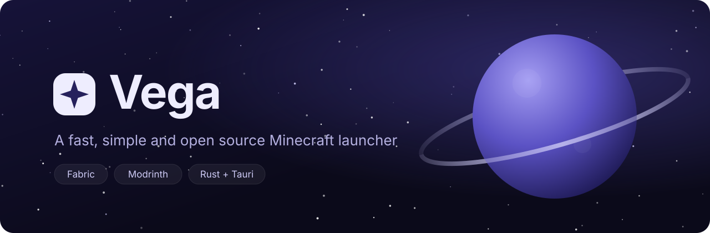
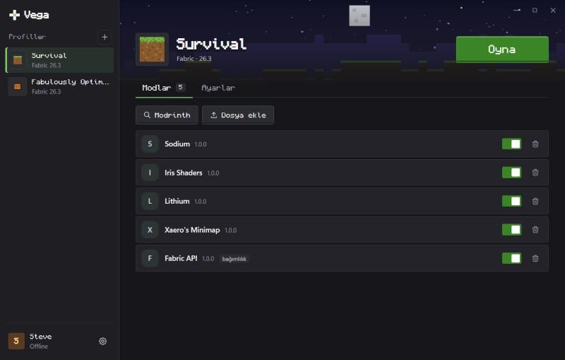
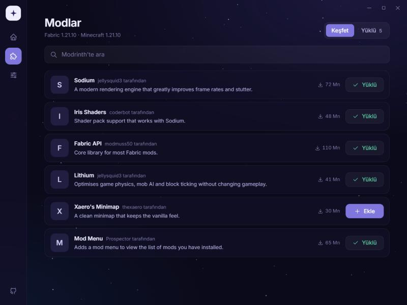
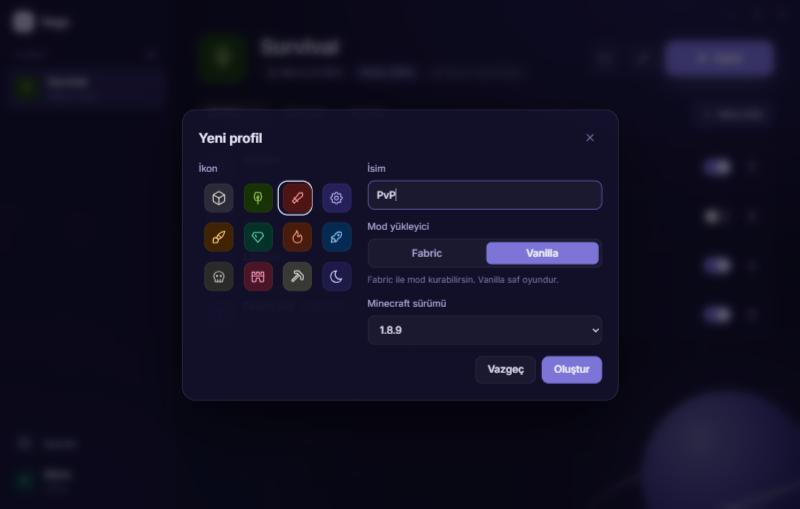

<p align="center">
  
</p>

<p align="center">
  <a href="https://github.com/matrixdurden/vega/actions/workflows/ci.yml"></a>
  <a href="https://github.com/matrixdurden/vega/releases"></a>
  <a href="LICENSE"></a>
  
  
  
</p>

<p align="center">
  <a href="README.md">English</a> · <b>Türkçe</b>
</p>

---

Vega, ayağına dolanmayan bir Minecraft launcher'ı. Sürümünü seç, Modrinth'ten birkaç mod ekle, **Oyna**'ya bas. Sadece eksik olanı indirir, her dosyayı doğrular, Java'sını kendisi getirir. Ağır işleri Rust yaptığı için de hafif kalır.

<table>
  <tr>
    <td colspan="2"></td>
  </tr>
  <tr>
    <td></td>
    <td></td>
  </tr>
</table>

## Özellikler

- **Her şey profilin etrafında.** Her profil sol panelde piksel sanat ikonu (ya da kendi resmin), Minecraft sürümü ve modlarıyla durur.
- **İstediğin client, istediğin gibi.** Bir client ya da mod `.jar` dosyasını profile sürükle bırak, ya da doğrudan jar'dan yeni profil oluştur.
- **Aynı anda birden fazla oyun.** Farklı profilleri yan yana çalıştır; her birinin kendi ilerlemesi, durdurma butonu ve logu var.
- **Modrinth mod paketleri.** Modrinth'teki Fabric mod paketlerini ara ve kur ya da bir `.mrpack` dosyasını içe aktar. Modları, ayarları ve istedikleri Fabric sürümüyle gelir.
- **Hesaplar.** Offline isimler ve Microsoft girişi (cihaz koduyla), birden fazla hesap yan yana.
- **Kapatılabilir modlar.** Bir modu silmeden kapatabilir ya da tamamen kaldırabilirsin. Fabric API gibi gerekli bağımlılıklar otomatik gelir.
- **Java dert değil.** Her Minecraft sürümünün istediği Java'yı Mojang'ın kendi derlemelerinden kurar.
- **Hızlı ve doğrulanmış indirme.** 32 paralel indirme, kaynağın hash yayınladığı her dosyada SHA-1 kontrolü, otomatik yeniden deneme, yarım dosya bırakmayan yazma.
- **Hızlı açılış.** Bir sürüm diskteyse Oyna'ya bastığında oyun açılmadan önce hiçbir ağ isteği yapılmaz.
- **Hiçbir şey iki kez inmez.** Kütüphaneler, asset'ler ve Java profiller arasında paylaşılır.
- **Hafif.** Rust çekirdek ve sistemin web görünümünde çalışan Svelte 5 arayüz. İçinde koca bir tarayıcı taşımaz, arka planda animasyon çalıştırmaz.
- **Türkçe ve İngilizce.**

## İndir

Windows, macOS ve Linux kurulum dosyaları [sürümler sayfasında](https://github.com/matrixdurden/vega/releases).

> [!WARNING]
> Meteor gibi hile client'ları çoğu sunucuda yasaktır. Tek oyunculu ya da izin veren sunucularda kullan.

### Microsoft girişi

Microsoft girişi için "Allow public client flows" açık olan ve Mojang'ın Minecraft API'si için onayladığı bir Azure uygulamasının kimliği gerekiyor ([başvuru](https://aka.ms/mce-reviewappid)). Vega bu kimliği derleme ya da çalışma anında `VEGA_MSA_CLIENT_ID` ortam değişkeninden okur. Sürüm iş akışı da aynı isimli bir depo secret'ından alır. Kimlik yoksa buton kapalı kalır, offline hesaplar yine çalışır. Lütfen oyunu satın al: offline mod oyuna zaten sahip olanlar için var.

## Yol haritası

- [x] İkonlu Vanilla ve Fabric profilleri, profile özel bellek
- [x] Bağımlılıklarıyla birlikte Modrinth arama ve kurulum, mod aç/kapat
- [x] Otomatik Java
- [x] Oyun konsolu ve çökme bildirimi
- [x] Offline ve Microsoft hesapları
- [x] `.jar` dosyasından client'lar ve Modrinth mod paketleri (`.mrpack`)
- [x] Aynı anda birden fazla oyun
- [ ] NeoForge ve Quilt
- [ ] Neyin bozulduğunu açıklayan çökme analizcisi
- [ ] Profil yedekleri ve tek tıkla geri alma
- [ ] Otomatik güncelleme

## Kaynaktan derleme

[Rust](https://rustup.rs) (stable), [Node.js](https://nodejs.org) 24 ve platformuna göre [Tauri gereksinimleri](https://v2.tauri.app/start/prerequisites/) gerekiyor. Debian veya Ubuntu'da:

```bash
sudo apt install libwebkit2gtk-4.1-dev build-essential curl wget file libxdo-dev libssl-dev libayatana-appindicator3-dev librsvg2-dev
```

Sonra:

```bash
git clone https://github.com/matrixdurden/vega.git
cd vega
npm install
npm run tauri dev      # uygulamayı canlı yenilemeyle çalıştırır
npm run tauri build    # kurulum dosyası üretir
```

Sadece arayüz üzerinde mi çalışıyorsun? `npm run dev` arayüzü sahte bir backend ile tarayıcıda açar, Rust gerekmez.

Launcher çekirdeğinin arayüz bağımlılığı yok, tek başına derlenip test edilebilir:

```bash
cargo test -p vega-core
# Gerçek uçtan uca deneme: Fabric 1.21.1 + Sodium, sonra oyun 60 saniye çalışır
cargo run -p vega-core --example smoke -- /tmp/vega-smoke 1.21.1 sodium 60
```

## Yapı

```text
crates/vega-core/   Rust launcher çekirdeği, arayüz kodu yok
  mojang.rs         Sürüm listesi, kütüphaneler, asset'ler, kurallar
  fabric.rs         Fabric loader profilleri
  java.rs           Mojang'ın Java runtime'ları
  modrinth.rs       Arama ve bağımlılık çözümlemeli kurulum
  launch.rs         java komut satırını oluşturur
  net.rs            Paralel, doğrulanmış, yeniden deneyen indirme
src-tauri/          Tauri kabuğu: komutlar, olaylar, oyun süreci
src/                Svelte 5 arayüzü
```

Oyun verileri Windows'ta `%APPDATA%\vega`, macOS'ta `~/Library/Application Support/vega`, Linux'ta `~/.local/share/vega` altında durur.

## Katkı

Issue ve pull request'ler açık. Pull request göndermeden önce şunları çalıştır:

```bash
cargo fmt --all && cargo clippy -p vega-core --all-targets -- -D warnings && cargo test -p vega-core
npm run check
```

## Lisans

Vega, [GNU General Public License v3.0 veya sonrası](LICENSE) ile lisanslanmış özgür bir yazılımdır. İçindeki [Monocraft](https://github.com/IdreesInc/Monocraft) yazı tipi Idrees Hassan'a aittir ve [SIL Open Font License](src/assets/fonts/OFL.txt) ile dağıtılır.

Vega resmi bir Minecraft ürünü değildir; Mojang veya Microsoft tarafından onaylanmamıştır ve onlarla bağlantılı değildir.
